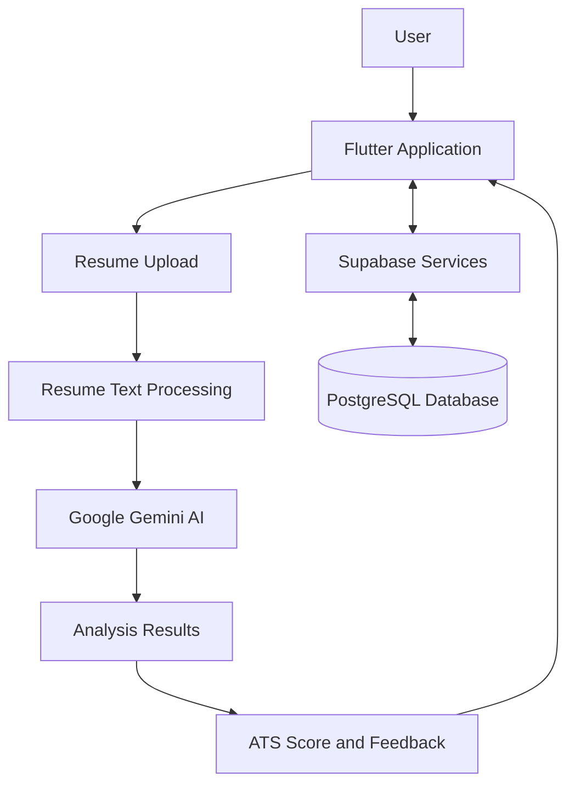

# 🚀 AI Based Resume Analyzer

### Smarter Resumes. Better Opportunities.

An AI-powered resume analysis application that helps students and job seekers improve their resumes through intelligent feedback, ATS scoring, and personalized suggestions.

<p align="center">
  
  
  
  
</p>

---

## 📌 About the Project

**AI Based Resume Analyzer** is an AI-powered application developed to help students, fresh graduates, and job seekers evaluate and improve their resumes.

Creating a professional resume that meets industry expectations and Applicant Tracking System (ATS) requirements can be challenging. This application uses Google Gemini AI to analyze resume content and provide useful feedback, helping users understand their strengths, weaknesses, and areas for improvement.

The project combines a Flutter-based user interface, Supabase backend services, PostgreSQL database technology, and AI-powered resume analysis.

## 🎯 Objectives

- Simplify the resume evaluation process.
- Generate an ATS-oriented resume score.
- Identify resume strengths and weaknesses.
- Provide personalized suggestions for improvement.
- Help users create clearer and more effective resumes.
- Maintain a user-friendly experience for students and job seekers.

## ✨ Key Features

| Feature | Description |
|---|---|
| 📄 Resume Upload | Upload a resume for AI-powered analysis. |
| 🤖 AI Analysis | Analyze resume content using Google Gemini AI. |
| 📊 ATS Score | Display a score to help evaluate resume quality. |
| 💪 Strengths | Identify positive aspects of the resume. |
| ⚠️ Weaknesses | Highlight areas that may need improvement. |
| 💡 Suggestions | Provide actionable recommendations for improvement. |
| 📚 Resume History | Access previous analysis records, where available. |
| 🔐 Authentication | Support user authentication through Supabase Auth. |

## 🛠️ Technology Stack

| Technology | Purpose |
|---|---|
| Flutter | Cross-platform application development |
| Dart | Application programming language |
| Supabase | Backend services and authentication |
| PostgreSQL | Relational database |
| Google Gemini AI | AI-powered resume analysis |
| REST API | Communication with external AI services |

## 🏗️ System Architecture



The Flutter application manages the user interface and resume-analysis workflow. Supabase provides backend services and database connectivity, while Google Gemini AI generates resume feedback.

## 🔄 How It Works

1. **Upload:** The user selects a resume.
2. **Process:** The application prepares the resume content for analysis.
3. **Analyze:** Google Gemini AI evaluates the supplied resume information.
4. **Generate Results:** The AI returns a structured analysis.
5. **Review:** The user views the score, strengths, weaknesses, and suggestions.
6. **Track:** Previous analysis records can be reviewed through the resume history feature, when available.

## 📱 Application Screens

The application is designed around a simple and user-friendly workflow.

- Login and authentication
- Dashboard
- Resume upload and analysis
- AI-generated analysis results
- Resume history

> **Screenshots:** Add your actual application screenshots here to help visitors understand the interface.

<!-- Replace the placeholder paths with screenshots committed to your repository. -->

<!--
<p align="center">
  
  
  
</p>
-->

## 📂 Project Structure

A simplified example of the project organization:

```text
ai-based-resume-analyzer/
├── android/
├── ios/
├── lib/
│   ├── controllers/
│   ├── services/
│   ├── views/
│   ├── models/
│   └── main.dart
├── test/
├── pubspec.yaml
├── analysis_options.yaml
└── README.md
```

*Note: This is an illustrative structure. Adjust it to match the actual folders in your repository.*

## ⚙️ Getting Started

### Prerequisites

Install the following tools before running the application:

- [Flutter SDK](https://docs.flutter.dev/get-started/install)
- [Dart SDK](https://dart.dev/get-dart)
- [Git](https://git-scm.com/)
- A Supabase project
- A Google Gemini API key

### 1. Clone the Repository

```bash
git clone YOUR_GITHUB_REPOSITORY_URL
```

### 2. Open the Project

```bash
cd ai-based-resume-analyzer
```

### 3. Install Dependencies

```bash
flutter pub get
```

### 4. Configure Environment Variables

Configure the required Supabase credentials and Gemini API key using the configuration method supported by your application.

If the project uses Dart compile-time environment variables, pass the exact variable names expected by your configuration service:

```bash
flutter run --dart-define=SUPABASE_URL=YOUR_SUPABASE_URL --dart-define=SUPABASE_ANON_KEY=YOUR_SUPABASE_KEY --dart-define=GEMINI_API_KEY=YOUR_GEMINI_API_KEY
```

**Security note:** Client-side environment variables are not a secure way to conceal secrets in a distributed mobile application. For production, protect the Gemini API key behind a server-side endpoint or Supabase Edge Function, and configure database Row Level Security (RLS).

### 5. Run the Application

```bash
flutter run
```

## 🗄️ Database Overview

The application uses PostgreSQL through Supabase to support persistent application data.

Potential core entities include:

- **Users:** User identity and account-related information.
- **Resumes:** Resume records associated with users.
- **Analysis Results:** Scores and AI-generated feedback.
- **Resume History:** Previous analysis records and metadata.

The actual database schema and Row Level Security policies should be documented according to the implemented Supabase tables.

## 🤖 AI Integration

Google Gemini AI powers the resume-analysis functionality.

The analysis workflow is designed to produce structured feedback, including:

- ATS-oriented score
- Resume strengths
- Resume weaknesses
- Personalized improvement suggestions

AI-generated scores and recommendations are estimates, not guarantees of ATS compatibility, job suitability, or employment outcomes.

## 🔒 Security Considerations

- Use Supabase authentication for account management.
- Apply Row Level Security to protect user-specific records.
- Never commit API keys, passwords, or other secrets to GitHub.
- Validate uploaded files and handle unexpected AI responses.
- Restrict access to private resume data.
- Keep production API credentials on a trusted server-side component.

## 🚧 Future Improvements

- Job-description-based resume matching
- Missing-skill identification
- Job-role recommendations
- More detailed ATS-oriented feedback
- Resume improvement guidance for different career levels
- Enhanced analysis history and reporting
- Additional resume formats and language support

## 👥 Project Team

**Course:** CSE 4104 — Software Development III  
**Section:** 7B  
**Team ID:** CSE4104-7B-T02

| Name | Role | ID |
|---|---|---|
| Sadik Hasnat | Team Leader | 1020 |
| Shahed Ahmed | Team Member | 1129 |
| Mohesena Zarin | Team Member | 1035 |

## 🎓 Academic Project

This project is developed as part of the CSE 4104 Software Development III course to apply software development, database management, API integration, and AI-assisted application design concepts.

## 📚 References

- [Flutter Documentation](https://docs.flutter.dev/)
- [Dart Documentation](https://dart.dev/guides)
- [Supabase Documentation](https://supabase.com/docs)
- [PostgreSQL Documentation](https://www.postgresql.org/docs/)
- [Google Gemini API Documentation](https://ai.google.dev/gemini-api/docs)

---

<p align="center">
  <b>Built with Flutter, Supabase, PostgreSQL, and Google Gemini AI.</b>
  <br />
  <i>Helping users build better resumes and pursue better opportunities.</i>
</p>
